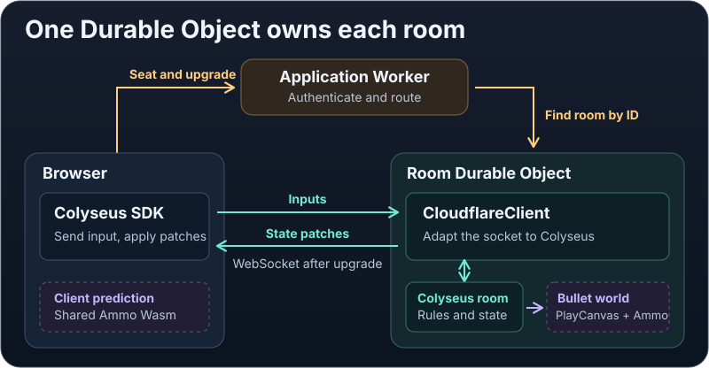
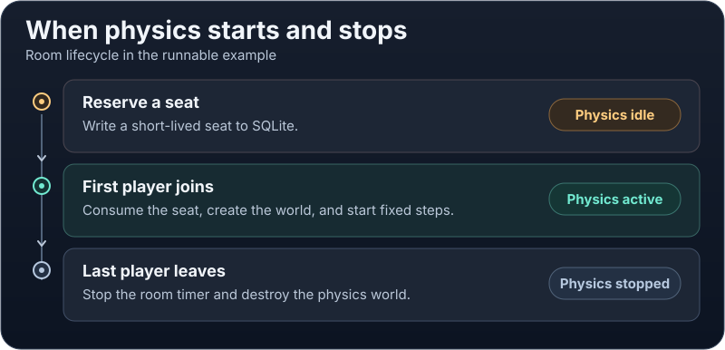

<div align="center">

# Colyseus Cloudflare

**Run Colyseus rooms and authoritative physics on Cloudflare Durable Objects.**

[](https://github.com/yocontra/colyseus-cloudflare/actions/workflows/ci.yml)
[](LICENSE)

</div>

This independent TypeScript adapter connects Colyseus rooms to Cloudflare
Durable Objects. Add headless PlayCanvas and Ammo/Bullet when the server needs
authoritative physics.

**Play the demo.** [Out West](https://contra.io/experiments/out-west/) uses the
library in Frontier multiplayer. [Open Frontier](https://contra.io/experiments/out-west/frontier/).

## Install

```sh
npm install colyseus-cloudflare
```

Use Node 24 or newer. The package exports ESM and TypeScript declarations.

## How it works

The application Worker routes each room to a Durable Object. The Object owns the
WebSockets, Colyseus room, and simulation. Colyseus handles room messages and
state synchronization. Your game defines the room state, validates player
commands, and decides what runs on each tick.

### What runs where

[](https://raw.githubusercontent.com/yocontra/colyseus-cloudflare/main/docs/room-architecture.svg)

Out West serves the same Ammo WebAssembly binary to the room and to browser
prediction. The server owns the authoritative state.

### When the room uses compute

[](https://raw.githubusercontent.com/yocontra/colyseus-cloudflare/main/docs/room-lifecycle.svg)

Each player needs a valid single-use seat for the WebSocket upgrade. The first
successful join starts the simulation. An expired or used seat requires a new
reservation. See the [Worker](example/worker.ts) and [physics room](example/physics-room.ts).

## Use it in a Worker

1. Bind a SQLite-backed Durable Object namespace in Wrangler with
   `new_sqlite_classes` and enable `nodejs_compat`.
2. Authenticate the browser in your Worker. Route seats and upgrades to the
   same Object. Use `DurableSeats` if you want SQLite-backed, single-use
   reservations.
3. In the Object, wrap the server socket with `CloudflareClient` and join it
   with Colyseus. Forward message events to `dispatch()` and socket closure
   to `disconnected()`.
4. When your room runs physics, load the Worker Wasm modules once with
   `initializeWorkerAmmo()`. Create a separate world for each active room,
   step it with a fixed timestep, and call `app.destroy()` when the room
   ends. See the [Worker](example/worker.ts), [physics room](example/physics-room.ts),
   and [Wrangler configuration](example/wrangler.jsonc).

The application owns authentication, room routing, game rules, and admission
policy. If a Durable Object restarts, clients need a new authenticated join.
The in-memory Colyseus room and Bullet world must be recreated.

| Package export                       | Purpose                                                                                                          |
| ------------------------------------ | ---------------------------------------------------------------------------------------------------------------- |
| `colyseus-cloudflare/transport`      | Adapt a Durable Object WebSocket to a Colyseus server client.                                                    |
| `colyseus-cloudflare/clock`          | Give Colyseus a clock that advances during quiet Worker timer callbacks. Match `stepMs` to your simulation tick. |
| `colyseus-cloudflare/seats`          | Issue and consume expiring seat reservations. Schedule an alarm from `nextExpiry()` and run `expire()` on wake.  |
| `colyseus-cloudflare/admission`      | Reserve budget for room duration and inbound frames in a shared SQLite ledger.                                   |
| `colyseus-cloudflare/worker-physics` | Load precompiled Ammo and callback Wasm modules in Wrangler.                                                     |
| `colyseus-cloudflare/physics`        | Create a headless PlayCanvas application and a room-owned Bullet world.                                          |
| `colyseus-cloudflare/ammo`           | Initialize Ammo with a compiled module or load it from a URL.                                                    |
| `colyseus-cloudflare/ammo.wasm`      | Serve the same Ammo binary to browser prediction code.                                                           |
| `colyseus-cloudflare/client`         | Optionally batch two reliable SDK input packets into one socket frame. Use with the matching server adapter.     |

Use `room.input({ type: InputSchema, mode: 'reliable' })` for SDK input streams
over this transport. The adapter rejects unreliable input frames. A client has
15 seconds to acknowledge the join and can queue up to 256 messages or 1 MiB
before it joins.

The input batcher sends pairs of eligible packets at once and flushes a lone
packet after 100 ms. Control packets pass through immediately and can overtake
queued inputs.

## Out West integration

| In Out West                                                                                                                     | What it does                                                                                            |
| ------------------------------------------------------------------------------------------------------------------------------- | ------------------------------------------------------------------------------------------------------- |
| [Town lobby](https://github.com/yocontra/yocontra.github.io/blob/master/api/src/town/lobby.ts)                                  | Authenticates the connection, consumes its seat, and connects the Durable Object WebSocket to Colyseus. |
| [Server room](https://github.com/yocontra/yocontra.github.io/blob/master/api/src/game/room.ts)                                  | Loads Worker Ammo and advances the authoritative Frontier simulation.                                   |
| [Physics world](https://github.com/yocontra/yocontra.github.io/blob/master/src/experiments/out-west/runtime/world.ts)           | Builds Frontier's bodies and collisions on the shared PlayCanvas physics wrapper.                       |
| [Browser session](https://github.com/yocontra/yocontra.github.io/blob/master/src/experiments/out-west/client/remote-session.ts) | Connects the Colyseus SDK and batches reliable player inputs.                                           |

## Run the example

From the repository root, install the [example](example/)'s dependencies from npm
and start Wrangler locally.

```sh
cd example
npm install
npm run dev
```

From a second terminal in `example/`, run `npm run smoke`. Three SDK clients
join two rooms. The test checks that a seat reservation leaves physics idle,
players see a box land and hop, and the second room keeps running after the
first room empties. The example uses local test identities.

## Keep rooms within your budget

Start physics and timers when a player joins. Stop them after the last player
leaves. A running room can consume Durable Object duration even when its sockets
are quiet.

To share a budget across rooms, keep `AdmissionLeases` in a single SQLite-backed
Object. Reserve and renew a lease per live room, report its final use when it
closes, and stop a room when renewal is denied. Unreported leases retain their
reservation for the day. Leases that cross midnight UTC carry their reservations
into the next day. Reported seconds count from midnight and the message count
since the last report is charged to the new day. The ledger tracks the
application's configured allowance. Cloudflare meters the account separately.
[Durable Objects pricing](https://developers.cloudflare.com/durable-objects/platform/pricing/) ·
[Workers limits](https://developers.cloudflare.com/workers/platform/limits/)

## Contributing

See [CONTRIBUTING.md](CONTRIBUTING.md) for checks, [SECURITY.md](SECURITY.md) for
private reporting, and [third-party notices](THIRD_PARTY_NOTICES.md) for the
bundled Ammo assets.
